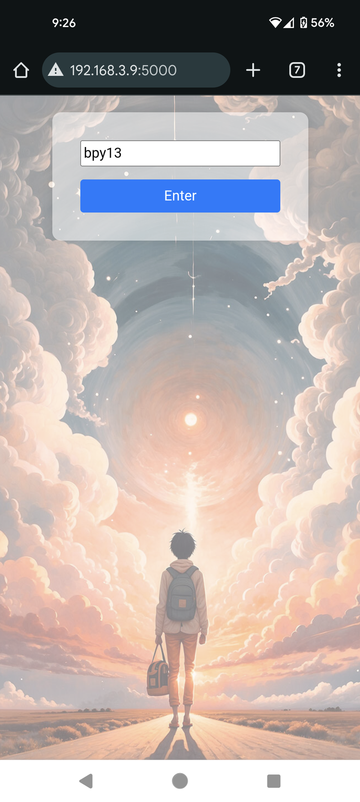
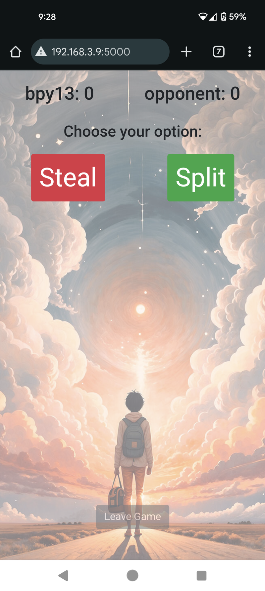
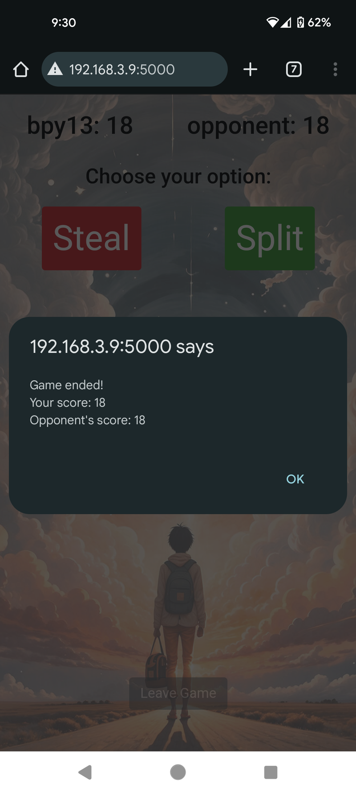

# Prisoner's Dilemma Game Lobby

A simple Flask-SocketIO server that hosts a game lobby for multiple rounds of the classic Prisoner's Dilemma. Players on the same network open the page on their phone or computer, pick a name, and challenge each other.

## Game Rules

The Prisoner's Dilemma is a classic game theory scenario where two players can either cooperate (**Split**) or betray each other (**Steal**). Each round, both players choose without seeing the other's choice:
- If both split, they both receive 3 points.
- If both steal, they both receive 1 point.
- If one steals and the other splits, the stealer receives 5 points and the splitter receives 0 points.

How a game works:
- **Challenges are accepted automatically.** Clicking a name in the lobby (or "Challenge a random player") starts a game with that player straight away; they cannot decline.
- A game lasts a random 5 to 9 rounds. Players are not told how many.
- Either player can leave early with "Leave Game". Closing the tab or losing the connection for more than 10 seconds also ends the game. Rounds already played still count, and the game counts as played.
- Your score is your **average points per round** across all your games.
- The leaderboard (`/leaderboard`) lists players by that average, highest first, and **only shows players who have played at least 7 games**.
- Scores live in the server's memory: they are kept if you log out and back in with the same name, but are lost when the server restarts.

## Screenshots

<p align="center">
  
  
  
  
</p>

## Setup

Requires Python 3.10 or later.

1. Clone the repository:
    ```powershell
    git clone https://github.com/bpy13/prisoners_dilemma.git
    cd prisoners_dilemma
    ```

2. Create the environment, either with conda (includes the test tools):
    ```powershell
    conda env create -f environment.yml
    conda activate prisoners_dilemma
    ```
    or with pip:
    ```powershell
    pip install -r requirements.txt        # to run the game
    pip install -r requirements-dev.txt    # to run tests and the linter
    ```

3. Optional: copy `.env.example` to `.env` and set a `SECRET_KEY` (see below). Never commit `.env`.

## Configuration

Settings are read from environment variables or from a `.env` file in the project folder.

| Variable | Default | What it does |
|---|---|---|
| `SECRET_KEY` | random at each start | Signs the login cookie. Without it, everyone is logged out when the server restarts. Generate one with `python -c "import secrets; print(secrets.token_hex(32))"`. |
| `DEBUG` | `0` | `1` turns on Flask debug mode (auto-reload, in-browser debugger). Only use it on a machine nobody else can reach: the debugger lets anyone who can open the page run code on your computer. |
| `HOST` | `0.0.0.0` | Address to listen on. `0.0.0.0` lets other devices on your network join; `127.0.0.1` keeps it to this computer. |
| `PORT` | `5000` | Port to listen on. |
| `DISCONNECT_GRACE_SECONDS` | `10` | How long a dropped connection (page reload, network blip) may take to come back before that player's game is ended and their name freed. |

## Usage

1. Run the server:
    ```powershell
    python app.py
    ```
    Stop it with Ctrl+C.

2. Open `http://<your-ip-address>:5000` on each device (or `http://localhost:5000` on the same computer).

This uses the built-in development server, which is fine for playing on a home or office network but not for hosting on the internet.

## Tests and linting

```powershell
python -m pytest
ruff check .
```

The tests simulate browsers with Flask-SocketIO's test client: a full match, invalid moves and challenges, closing a tab and logging out mid-game, and the leaderboard order.

## Project layout

- `game.py` – players, matches and scoring (no web code)
- `app.py` – web pages and Socket.IO events
- `static/socketIO.js`, `templates/` – the browser side
- `tests/` – automated tests
- `docs/` – decisions, open items and plans

## License

This project is licensed under the MIT License.
